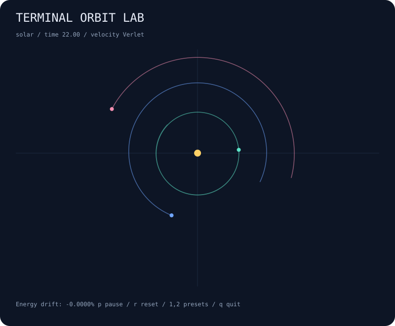

# terminal-orbit-lab

A little gravity sandbox that lives in your terminal. Watch a miniature solar system or a pair of orbiting stars leave colored trails, then pause, change speed, or zoom in.



## Run

```bash
npx --yes github:b69ca/terminal-orbit-lab
npx --yes github:b69ca/terminal-orbit-lab --preset binary
```

Node.js 20 or newer. No runtime dependencies. Everything runs locally.

## Play

| Key | Action |
| --- | --- |
| `p` or Space | Pause / resume |
| `r` | Reset the current preset |
| `1` / `2` | Solar / binary preset |
| `+` / `-` | Faster / slower simulation |
| `]` / `[` | Zoom in / out |
| `q` or Ctrl-C | Quit and restore the terminal |

Stars are `*`, planets are `o`, and trails are `.`. A live session uses the alternate terminal screen and hides the cursor; quitting restores the screen, cursor, and input mode. `--no-color` or `NO_COLOR=1` disables colors.

## Capture a moment

```bash
# A portable picture, ready for a README or wallpaper
npx --yes github:b69ca/terminal-orbit-lab --steps 2200 --svg orbit.svg

# Reproducible physics state with an energy-drift diagnostic
npx --yes github:b69ca/terminal-orbit-lab --preset binary --steps 10000 --json

# A finite animation, or one plain frame when output is piped
npx --yes github:b69ca/terminal-orbit-lab --frames 200
npx --yes github:b69ca/terminal-orbit-lab --steps 2200 --frames 1 > frame.txt
```

## Options

```text
--preset solar|binary  choose a system (default: solar)
--steps N             advance before rendering; 0–100000
--frames N            stop after N terminal frames; 0–100000
--json                print the state instead of animating
--svg FILE            save a static SVG instead of animating
--no-color            disable ANSI colors
--help                show usage
```

`--json` and `--svg` can be combined; `--frames` cannot be combined with either. Without a TTY, terminal output defaults to one frame and contains no ANSI escape sequences. Each frame advances four physics steps initially. JSON and SVG output advance only the requested `--steps`.

## Under the hood

Pairwise gravity uses normalized units with G = 1, a fixed time step of 0.01, and softening of 0.03. Velocity Verlet integrates the motion. Systems start in the center-of-mass frame, and a bounded trail samples every fifth physics step. The HUD measures relative drift from the initial softened total energy.

This is an educational toy: there are no physical units, collisions, merging bodies, or adaptive time steps. The presets approximate orbits rather than a measured astronomical system. The SVG exporter uses a fixed viewport; terminal zoom does not affect it.

## Library

```js
import { createWorld, step, analyze, render } from 'terminal-orbit-lab';
const world = createWorld({ preset: 'binary' });
step(world, 1000); // Mutates world and returns it.
console.log(analyze(world));
console.log(render(world, { width: 80, height: 24 }));
```

Clone the repository and run `npm ci` followed by `npm run check`. Tests check long-run energy and momentum conservation, rendering, argument errors, and file exports. GitHub Actions runs on Node.js 20, 22, and 24.

## License

MIT
